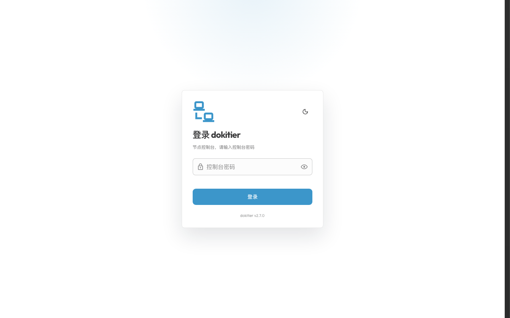
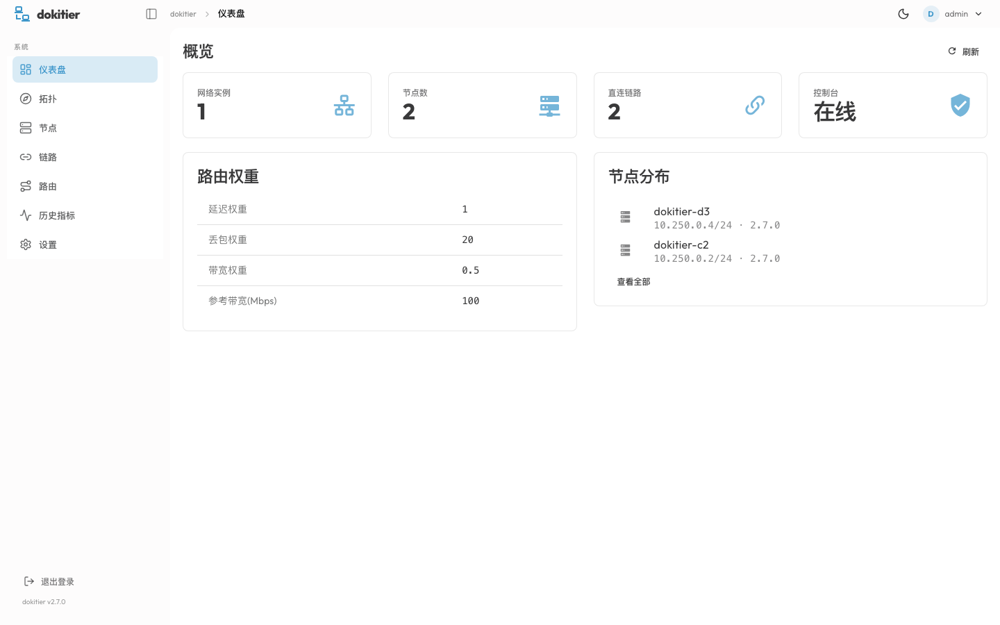
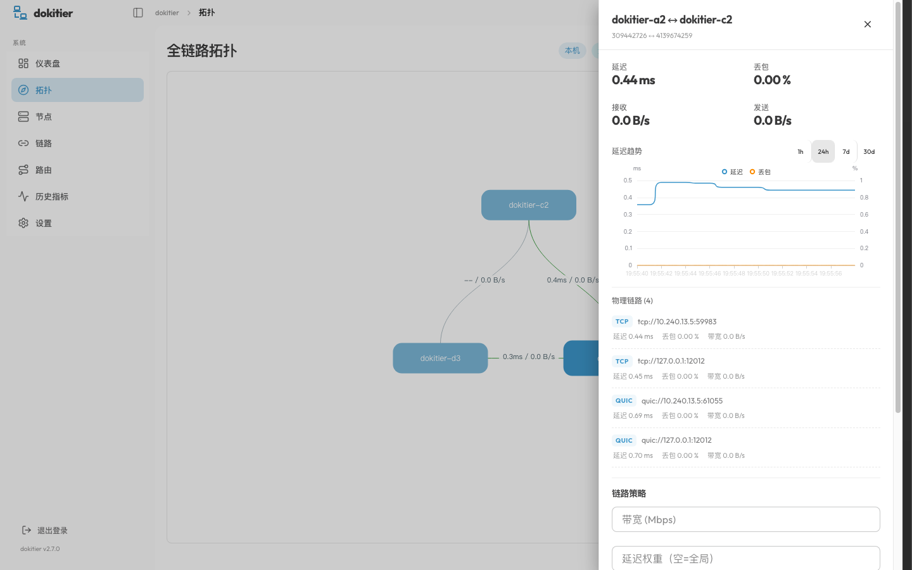
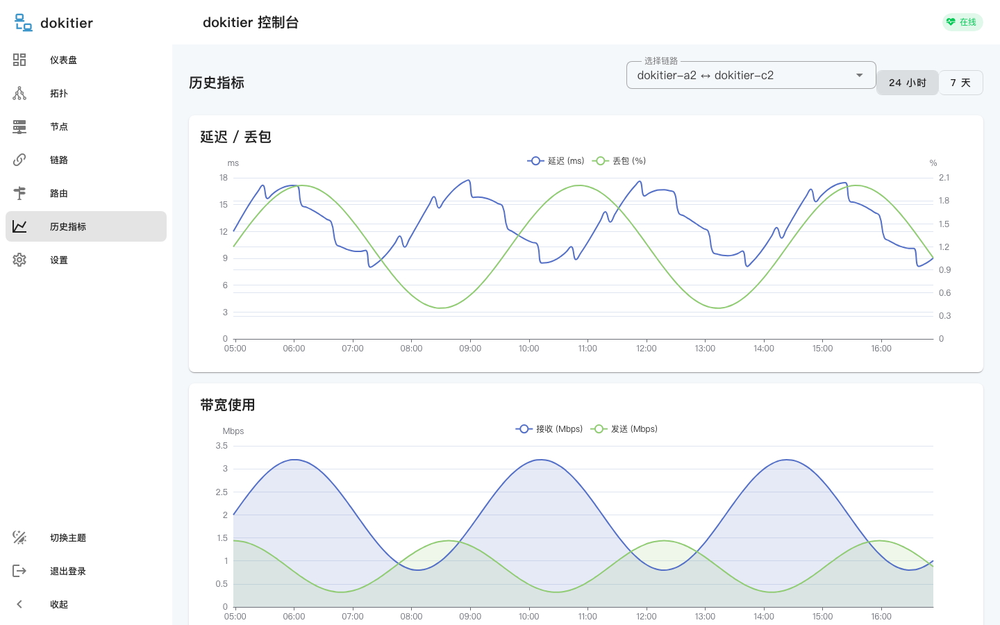
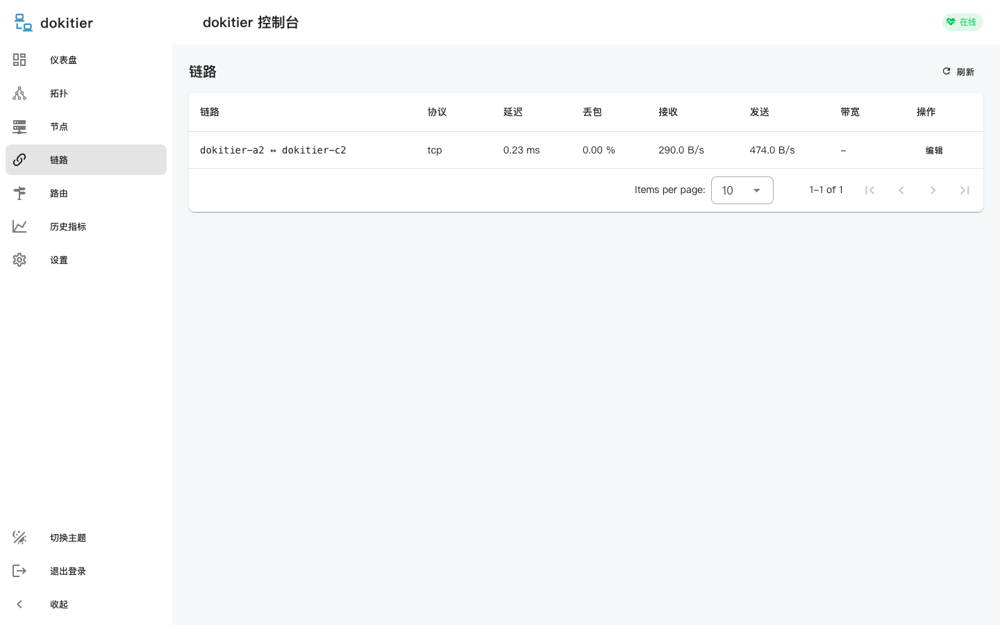

> **基于 EasyTier 修改**：dokitier 是 [EasyTier](https://github.com/EasyTier/EasyTier) 的修改版（fork），
> 在原版基础上增加了 dokitier 控制台、路由权重、P2P 分组等能力。
> 原始版权与许可证见 `LICENSE`，上游项目版权归 EasyTier 作者所有。

## 仓库结构

```
core/                 dokitier-core 二进制（Agent，仅上报/执行控制台配置）
console/              独立控制台 dokitier-console（Web UI + Agent 接入 + 数据库）
dokitier-controller/  core 与 console 共用的连接/协议代码
dokitier-core/        网络核心库
dokitier-proto/       protobuf 定义
dokitier-web/         控制台前端（Vue 3 + Vuetify + ECharts）
```

# dokitier

EasyTier fork renamed to dokitier, with a built-in web console, SQLite config store,
per-link routing weights and planned full-mesh config sync.

## Build

```bash
export PROTOC=$PWD/.tools/protoc/bin/protoc
export CARGO_HOME=$PWD/.cargo-home
cargo build -p dokitier --features web-console
```

Frontend:

```bash
cd dokitier-web/webui
npm install --cache .npm-cache
npm run build          # outputs dokitier-web/webui/dist, embedded via include_dir
```

Rebuild the Rust binary after the frontend build so assets are embedded.

### Linux x86_64 build via Docker (no external builder)

```bash
docker run --rm --platform linux/amd64 \
  -v "$PWD":/src -w /src \
  -v "$PWD/.docker-target-x64":/target \
  -e CARGO_TARGET_DIR=/target \
  rust:1.95-bookworm bash -c '
    apt-get update -qq &&
    apt-get install -y -qq protobuf-compiler clang libclang-dev cmake \
      pkg-config libssl-dev zlib1g-dev git mold >/dev/null &&
    cargo build --release -p dokitier --features web-console'
# result: .docker-target-x64/release/dokitier-core
```

The repo `.cargo/config.toml` links with `mold`, so `mold` must be installed
in the build environment.

## Web console config

```toml
[web_console]
enabled = true
listen = "0.0.0.0:11211"
password = "change-me"
# optional
session_ttl_hours = 12
db_path = "/var/lib/dokitier/web.db"

[routing]
latency_weight = 1.0
loss_weight = 20.0
bandwidth_weight = 0.5
reference_bandwidth_mbps = 100.0
# weighted: use latency/loss/bandwidth cost for every packet (default)
# least_hop: classic shortest-hop first, weights only break ties
mode = "weighted"
```

Sync peers can be pinned explicitly (useful when consoles are not on the
overlay address or use different ports):

```toml
[web_console]
sync_peers = ["10.126.126.4:11211", "10.126.126.5:11211"]
```

If `[web_console]` is missing or `enabled = false`, the console is not started
and the node does not create the SQLite database, does not sample metrics and
does not pull configuration from peers. `[routing]` weights still apply.

## Metrics

- 1-second sampler reads peer connection stats (latency, loss, rx/tx) into memory.
- Memory keeps the last 60 samples per link for realtime views.
- A snapshot is persisted to SQLite every 60 seconds for 24h / 7d charts.
- WebSocket `/api/events` pushes 1-second metric updates to the SPA.

## Screenshots











## Status

Implemented: rename, config sections, SQLite schema, metrics hub, web API,
topology/nodes/links/routes/history/settings pages, login, per-link and global
routing weights, static routes, console-off semantics, peer-to-peer config sync
(pull + LWW + backoff + conflicts), 60s metric persistence.

Planned next: full-mesh config sync over overlay RPC, per-link weight application
in the OSPF cost function, static route lookup in the send path, complete global
topology adjacency for non-local edges.

### P2P 分组隔离

节点可配置 P2P 分组，跨组禁止自动直连（打洞/直连），只能通过显式 `[[peer]]` 地址互通：

```toml
p2p_group = "cn"   # 同一 network 内生效；留空表示不分组

[[peer]]
uri = "tcp://relay.example.com:11010"   # 手工指定对端，跨组允许
```

规则：

- 同组节点：允许自动 P2P（Direct / TCP 打洞 / UDP 打洞）
- 不同组：自动 P2P 在握手后拒绝，连接关闭
- `Manual`（主动指定 peer）和 `Listener`（被指定方接受的入站）连接不受分组限制
- 未配置分组的节点（或旧版本对端）保持原有行为
- 握手协议新增 `p2p_group` 字段，旧版本对端不发送时视为未分组

典型用法：`cn` 与 `overseas` 分组各自只和专线/中继节点配置 `[[peer]]`，两侧普通节点互相不可自动直连。

